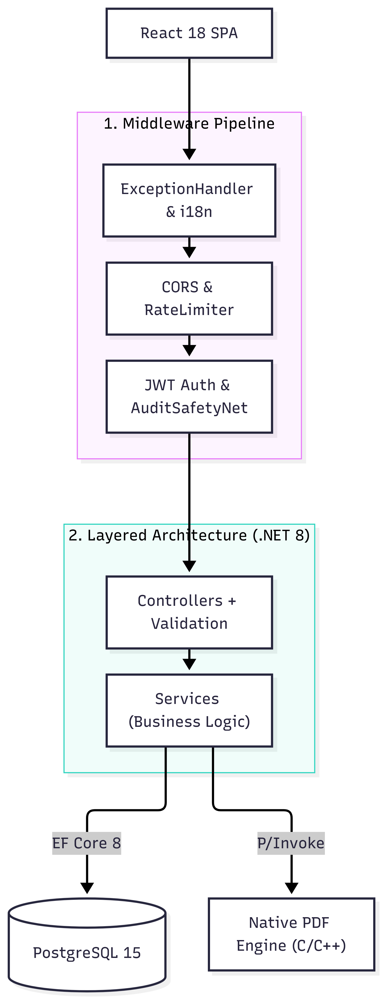
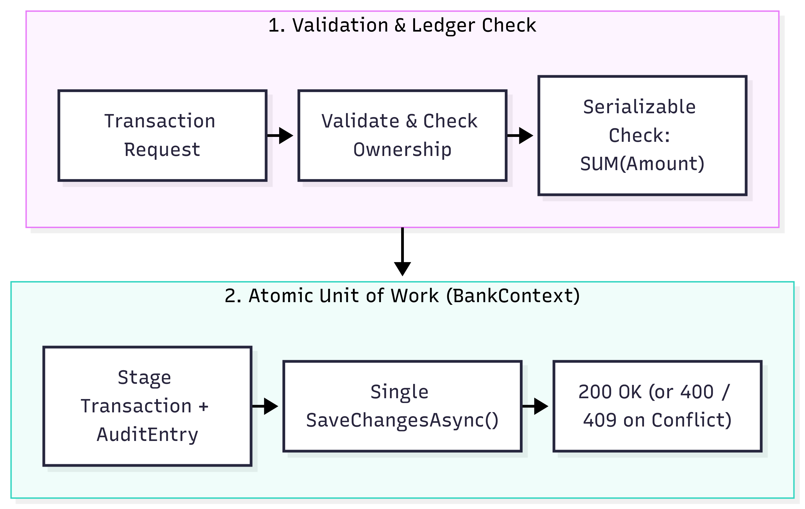
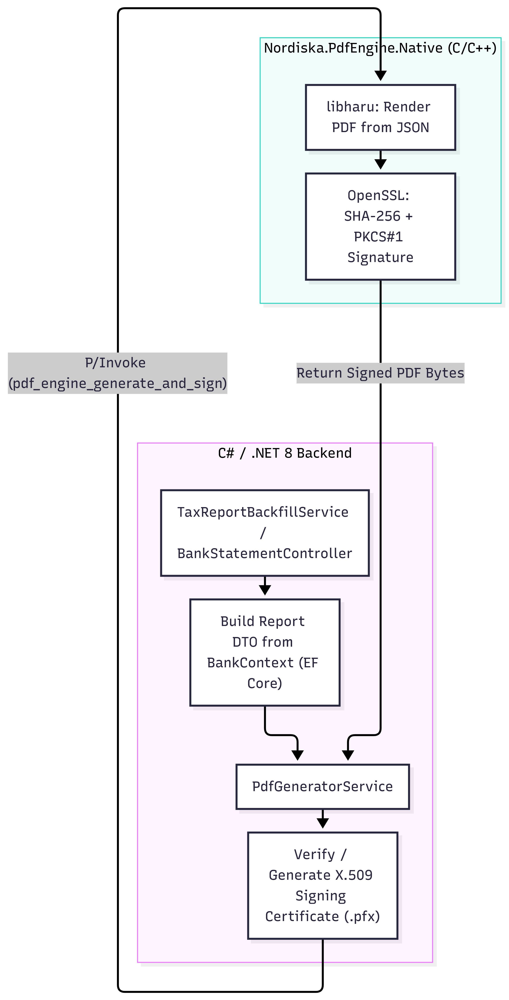

# Nordiska Sparbanken (v2) — Customer Portal

[](https://dotnet.microsoft.com/)
[](https://react.dev/)
[](https://www.typescriptlang.org/)
[](https://vitejs.dev/)
[](https://tailwindcss.com/)
[](https://www.postgresql.org/)
[](https://www.docker.com/)
[](https://www.nuget.org/packages/Nordiska.PdfEngine.Native)

Team 2's full refactoring of the Nordiska Sparbanken self-service portal from the legacy v1 Razor Pages monolith to a secure, scalable v2 architecture (.NET 8 Web API, React 18 SPA, PostgreSQL, and a native C/C++ PDF engine).

---

## Table of Contents

1. [What's New in v2](#whats-new-in-v2)
2. [Tech Stack](#tech-stack)
3. [Backend Overview (.NET 8 / C#)](#backend-overview-net-8--c)
4. [Project Structure](#project-structure)
5. [Prerequisites & Environment Variables](#prerequisites--environment-variables)
6. [Quickstart](#quickstart)
7. [Scripts & Tooling](#scripts--tooling)
8. [Service URLs & Test Accounts](#service-urls--test-accounts)
9. [BankID Testing (Real Test Environment)](#bankid-testing-real-test-environment)
10. [Testing & Status](#testing--status)
11. [Architecture Decision Log (ADR)](#architecture-decision-log-adr)
12. [Known Limitations & Scope](#known-limitations--scope)
13. [Troubleshooting](#troubleshooting)

---

## What's New in v2

- **Immutable Ledger Accounting:** Eliminates v1 race conditions. Balances are dynamically computed via `SUM(SignedAmount)` using `Serializable` isolation for withdrawals and transfers.
- **Modern Auth & Security:** Replaces MD5 hashes and 365-day cookies with `BCrypt`, short-lived in-memory JWTs, `HttpOnly` refresh tokens, and a mocked BankID flow.
- **Native C/C++ PDF Engine (`Nordiska.PdfEngine.Native`):** Replaces blocking `Thread.Sleep` calls with a high-speed C/C++ engine (`libharu`, `PoDoFo`, `OpenSSL`) for batch generation and digital signing (`.pfx` / PKCS#12) of tax reports and bank statements (see [`native/README.md`](native/README.md)).
- **React 18 SPA & i18n:** Responsive Vite + React + TypeScript portal with full Swedish and English support (`Accept-Language`).
- **Rule-Based FAQ:** Database-backed FAQ search with keyword normalization, relevance scoring, and category filtering.
- **Observability & Protection:** Atomic database audit logging (`AuditEntry`) with a safety-net middleware, endpoint rate limiting, structured `ProblemDetails` error handling, and `/health` checks.
- **Optional Local AI Assistant:** A separate, removable API (`NordiskaPortal.Assistant`) backed by a local Ollama model, with a chat bubble in the portal.

---

## Tech Stack

| Layer | Technologies | Responsibility |
|---|---|---|
| **Frontend** | React 18, TypeScript, Vite, Tailwind CSS, TanStack Query, React Router v7, Zustand, Axios, i18next | SPA with BankID/email login, dashboard, transfers, bank statements, savings goals, tax reports, and FAQ. |
| **Backend API** | .NET 8 (C#), ASP.NET Core Web API, EF Core 8, FluentValidation, Scalar | Layered REST API (`Controllers` → `Services` → `BankContext`), JWT auth, rate limiting, and audit trail. |
| **Database** | PostgreSQL (12 in Docker Compose / 15 in Testcontainers) | Relational database managed via EF Core Code-First migrations. |
| **Native Engine** | C11 / C++17, CMake 3.25+, libharu, PoDoFo, OpenSSL 3.x, cJSON, zlib | High-throughput PDF generation and digital signing packaged as [`Nordiska.PdfEngine.Native`](native/README.md). |
| **Infrastructure** | Docker, Docker Compose, GitHub Actions | Containerized local development, CI/CD, and deployment. |
| **AI Assistant (optional)** | .NET 8 Web API, Ollama, `qwen2.5:3b` | Local chat assistant behind the same JWT as the bank API. Can be removed without touching the bank. |

---

## Backend Overview (.NET 8 / C#)

*(For frontend details see [`frontend/mappstruktur.md`](frontend/mappstruktur.md); for native C/C++ details see [`native/README.md`](native/README.md)).*

### 1. Request Pipeline & Layered Architecture
Incoming requests pass through the ASP.NET Core middleware pipeline (exception handling, localization, CORS, rate limiting, JWT auth, and audit verification) before reaching controllers and services.



### 2. Transaction, Ledger & Audit Flow (Unit of Work)
Deposits are pure inserts, while withdrawals and transfers execute inside a `Serializable` database transaction. Business state changes and `AuditEntry` records share the same scoped `BankContext` and commit atomically in a single `SaveChangesAsync()` call.



### 3. PDF Generation & Signing Flow (.NET ↔ Native C/C++)
`PdfGeneratorService` serializes report models to JSON, ensures an X.509 signing certificate (`.pfx`) exists, and invokes `Nordiska.PdfEngine.Native` via P/Invoke to generate and cryptographically sign PDFs.



---

## Project Structure

```text
nordiska-team2/
├── backend/
│   ├── NordiskaPortal.Api/          # .NET 8 Web API (Controllers, Services, Data, Models, Middleware)
│   │   ├── Certs/                   # Public BankID test CA certificate only (never client certificates)
│   │   └── Scripts/                 # dockerV2.ps1, docker.ps1, reset-db.sh
│   ├── NordiskaPortal.Api.Tests/    # xUnit unit & integration tests
│   ├── NordiskaPortal.Assistant/    # Optional local AI assistant API (Ollama)
│   └── NordiskaPortal/              # Legacy v1 Razor Pages monolith (reference)
├── frontend/                        # React 18 + TypeScript + Vite SPA
├── infra/                           # Docker Compose configuration & .env.example
│                                    #   docker-compose.yml (+ .override.yml), .assistant.yml,
│                                    #   .frontend.yml, .bankid.yml (add-ons used by dockerV2.ps1)
├── native/                          # C/C++ PDF Engine source & NuGet packaging
└── docs/                            # Project specifications & architecture diagrams (docs/images/)
```

---

## Prerequisites & Environment Variables

### Prerequisites
- **Git** & **Docker Desktop** (WSL 2 enabled on Windows)
- **.NET 8 SDK** & `dotnet-ef` CLI (`dotnet tool install --global dotnet-ef`)
- **Node.js** (v18/v20+) & `npm`

### Environment Files (`.env`)
Real `.env` files are git-ignored. Copy the provided `.env.example` templates before starting:

1. **`infra/.env`** (copied from [`infra/.env.example`](infra/.env.example)):
   ```env
   DB_PASSWORD=nordiska123
   JWT_KEY=dev_jwt_secret_key_minimum_32_characters_for_local_testing_only_123456
   CORS_ORIGIN=http://localhost:5173
   
   # Optional: AI assistant
   ASSISTANT_MODEL=qwen2.5:3b
   OLLAMA_CPUS=4
   ```
   - `DB_PASSWORD`: PostgreSQL container password and API connection string password.
   - `JWT_KEY`: Signing key for JWT access tokens (minimum 32 chars).
   - `CORS_ORIGIN`: Allowed frontend origin.
   - `ASSISTANT_MODEL`: Ollama model.
   - `OLLAMA_CPUS`: CPU limit for the assistant.

2. **`frontend/.env`** (copied from [`frontend/.env.example`](frontend/.env.example)):
   ```env
   # Use http://localhost:8080/api for Docker Compose, or http://localhost:5063/api for local 'dotnet run'
   VITE_API_BASE_URL=http://localhost:8080/api
   VITE_BANKID_MOCK=true
   ```
   - `VITE_ASSISTANT_BASE_URL`: where the chat bubble reaches the AI assistant.
   - `VITE_BANKID_MOCK=true` shows the "Testläge: simulera mobilen" box that approves mock BankID logins. Set it to `false` when using real test BankID.
   - Personal overrides go in `frontend/.env.development.local` (git-ignored). During `npm run dev`, Vite loads `.env` → `.env.development` → `.env.development.local`, and later files win.
   - `VITE_` values are read when the dev server starts (and baked in at build time in Docker), restart or rebuild after changing them.
> [!NOTE]
> **Secrets Management:** `.env.example` files contain safe defaults for local testing only. Production/staging secrets are injected directly by the hosting platform (see [`DRIFT.md`](DRIFT.md)). When running the API locally without Docker, use `.NET User Secrets`.

---

## Quickstart

### Full Stack with One Script (`dockerV2.ps1`, Windows)
 
Starts PostgreSQL, the API, the AI assistant (Ollama) and a production build of the frontend, resets the database to the committed migrations, and waits until every service answers. It **never** modifies `Migrations/`.
 
1. **Create `.env` files** (see [Environment Files](#environment-files-env)):
```powershell
   Copy-Item infra\.env.example infra\.env
   Copy-Item frontend\.env.example frontend\.env
```
 
2. **Start Docker Desktop**, then run the script:
```powershell
   cd backend/NordiskaPortal.Api/Scripts
   ./dockerV2.ps1                     # everything
```
   The first run downloads the AI model (`qwen2.5:3b`, ~2 GB); later runs only check it. Re-run the script after pulling new code. Resets the database to a clean state.
 
```powershell
   # Optional settings
   ./dockerV2.ps1 -SkipAssistant      # without Ollama / AI assistant (faster, less RAM)
   ./dockerV2.ps1 -SkipFrontend       # without the frontend container (use npm run dev instead)
   ./dockerV2.ps1 -BankId mock        # mock BankID (the default; same as no -BankId)
   ./dockerV2.ps1 -BankId real        # real BankID test environment (see BankID Testing); -RealBankId also works
```
 
3. **Open [http://localhost:8081](http://localhost:8081)** and log in with a [test account](#seeded-test-accounts). With `-SkipFrontend`, run `cd frontend && npm install && npm run dev` and open [http://localhost:5173](http://localhost:5173) instead.
> [!NOTE]
> **BankID in Docker:** by default the script runs the **mock**, the API as `Development` and the frontend built with the **"Testläge: simulera mobilen"** box. Log in via the **BankID** tab with either button and approve as a customer in that box. `-BankId real` switches both to the real test environment (API as `Production`, no Testläge box).
 
---

## Scripts & Tooling

| Script | Path / Command | What It Does & When to Use It |
|---|---|---|
| **`dockerV2.ps1`** (Windows) | `.\backend\NordiskaPortal.Api\Scripts\dockerV2.ps1` | **Full Stack Setup & Reset:** Checks prerequisites and `infra/.env`, resets the database to the committed migrations (never regenerates them), starts the API, AI assistant and frontend containers, and waits for each one. Flags: `-SkipAssistant`, `-SkipFrontend`, `-BankId mock|real` (mock is the default; `-RealBankId` = `-BankId real`). Keeps the downloaded AI model between runs. |
| **`docker.ps1`** (Windows) | `.\backend\NordiskaPortal.Api\Scripts\docker.ps1` | **Full DB & Docker Reset:** Reads `DB_PASSWORD` from `infra/.env`, recreates EF migrations (`InitialCreate`), runs `docker compose down -v`, rebuilds `app`, starts containers, and applies migrations. Run when migrations conflict or you want fresh seed data. |
| **`reset-db.sh`** (macOS/Linux/WSL) | `./backend/NordiskaPortal.Api/Scripts/reset-db.sh` | Bash equivalent of `docker.ps1`. |
| **Frontend scripts** | `cd frontend && npm run <script>` | `dev` (start Vite), `build` (typecheck + bundle), `lint` (ESLint), `test` (Vitest). |
| **Native build & test** | `cd native && just <target>` | Managed via `devenv` and `just` (`just build`, `just test`, `just run`). See [`native/README.md`](native/README.md). |

---

## Service URLs & Test Accounts

### Service URLs
| Service | URL | Notes |
|---|---|---|
| **Frontend Portal (Docker)** | `http://localhost:8081` | Production build, started by `dockerV2.ps1` |
| **Frontend Portal (dev)** | `http://localhost:5173` | React SPA via `npm run dev` (with `-SkipFrontend`) |
| **Backend API** | `http://localhost:8080` | (`http://localhost:5063` when running via `dotnet run`) |
| **Scalar API Docs** | `http://localhost:8080/scalar/v1` | Interactive OpenAPI documentation |
| **Health Check** | `http://localhost:8080/health` | API + PostgreSQL health probe |
| **AI Assistant** | `http://localhost:5080` | Optional, skipped with `-SkipAssistant` |
| **PostgreSQL** | `localhost:5433` | User: `nordiska` / DB: `nordiska` |

### Seeded Test Accounts

Log in using: 
 - **Email & Password**.
 - **BankID (Mock)**: BankID tab → start a login → approve as a customer in the **"Testläge: simulera mobilen"** box (the default with `dockerV2.ps1`; with `npm run dev` it needs `VITE_BANKID_MOCK=true` and the API running as `Development`)
 - **BankID (Real)**: See section [BankID Testing](#bankid-testing-real-test-environment)

| Name | Email | Password | Personal ID (BankID) | Seeded Accounts |
|---|---|---|---|---|
| **Anna Lindqvist** | `anna@example.com` | `password123` | `19850505-1234` | `NKM-10001` (Savings, 3.5%)<br>`NKM-10002` (Savings, 3.5%) |
| **Erik Johansson** | `erik@example.com` | `password123` | `19991212-5678` | `NKM-20001` (Savings, 3.5%) |
| **Developer** | `dev@example.com` | — | Your test personal number (see [BankID Testing](#bankid-testing-real-test-environment)) | For real test BankID login |

---

## BankID Testing (Real Test Environment)
 
Log in with a real **test** BankID against BankID's official test environment. Only needed when working on BankID. Without this setup, the mock is used. Verified on Windows with the BankID desktop app on the same device.
 
0. **Prepare the BankID app for test (one-time, PC):** Install BankID Security Application, start it once, and exit via **File → Exit**. Create `%APPDATA%\BankID\Config\CavaServerSelector.txt` containing `kundtest`, then start the app again, its log should say *"Using kundtest servers"*. (See [developers.bankid.com/test-portal/bankid-for-test](https://developers.bankid.com/test-portal/bankid-for-test).)
   > On a phone, switching to test mode means reinstalling the app, which **removes your real BankID** from that phone. Only use a spare device.
1. **Add the certificate files to `C:\Certs\BankID-Test`:** Download the test certificate zip from BankID's developer site (*bankid.com → Developers → Test*) and extract it there. The client certificate is `FPTestcert5_20240610.p12` (public test password `qwerty123`). Keep it **outside the repo**.
2. **Create a test BankID user:** Go to the test portal **[developers.bankid.com/test-portal/testing/identify](https://developers.bankid.com/test-portal/testing/identify)** → **Request code** → enter the code → **copy the personal number** → **Install BankID if required** → choose a password.
3. **Add this to `infra/.env`:**
```env
   BANKID_CERT_PATH=C:/Certs/BankID-Test/FPTestcert5_20240610.p12
   BANKID_CERT_PASSWORD=qwerty123
   BANKID_TEST_PERSONAL_ID=<the personal number from step 2>
   BANKID_TEST_CUSTOMER_EMAIL=dev@example.com
```
 
4. **Run the script in real mode from the script folder in NordiskaPortal.Api:**
```powershell
   cd backend/NordiskaPortal.Api/Scripts
   ./dockerV2.ps1 -BankId real        # or: ./dockerV2.ps1 -RealBankId
```
   Before the confirmation it shows **"BankID: REAL test environment."** The API runs as `Production` with your certificate, the frontend is rebuilt **without** the Testläge box, and after the database reset your test personal number is linked to the customer in `BANKID_TEST_CUSTOMER_EMAIL` (default `dev@example.com`).
 
5. **Log in:** Open the portal → **BankID** tab → **Logga in med BankID** → approve in the BankID app with your password → you land on the Developer customer's dashboard.
6. **Back to the mock:** run `./dockerV2.ps1` (or `-BankId mock`). The `BANKID_*` lines can stay in `infra/.env`.
> [!NOTE]
> The frontend is rebuilt differently in each mode. If the page still behaves like the previous mode after switching, your browser kept the old build: reload with **Ctrl+F5**, use a private window, or clear the site data for `localhost:8081` (F12 → Application → Storage → **Clear site data**).
 
**Running the API with `dotnet run` instead:** import the `.p12` into `Cert:\CurrentUser\My`, then set `dotnet user-secrets set "BankId:UseRealApi" "true"` and `dotnet user-secrets set "BankId:ClientCertificateThumbprint" "<thumbprint>"`, and set `VITE_BANKID_MOCK=false` in `frontend/.env.development.local`.
 
---

## Testing & Status

All automated test suites across Backend, Frontend, and Native pass.

- **Backend (`.NET xUnit`):** Unit and integration tests covering ledger calculations, concurrent withdrawals/transfers, JWT/BankID auth, account lifecycle, native PDF P/Invoke & error codes, atomic audit logging, FAQ scoring, and localization (`sv`/`en`). Requires Docker (Testcontainers).
  ```bash
  dotnet test backend/NordiskaPortal.Api.Tests/NordiskaPortal.Api.Tests.csproj
  ```
- **Frontend (`Vitest`):** Component and user-flow tests focusing on high-risk money movement modals (invalid amounts, insufficient balance, same-account prevention), bank statement filtering, FAQ, and UI building blocks.
  ```bash
  cd frontend && npm test -- --run
  ```
- **Native (`CTest`, `Valgrind`, `ASan`):** Unit/integration tests, memory-safety checks, and throughput benchmarks. For full build and test documentation, see [`native/README.md`](native/README.md).
- **BankID (manual):** Same-device login with the BankID desktop app against the official test environment verified end to end.

---

## Architecture Decision Log (ADR)

| Area | Decision | Rationale |
|---|---|---|
| **Ledger & Concurrency** | Immutable Ledger (`SUM(SignedAmount)`) + `Serializable` isolation | Structurally prevents balance corruption. Deposits are append-only inserts; withdrawals/transfers detect concurrent overdraft attempts via PostgreSQL serialization. |
| **Audit Trail** | Shared Scoped `BankContext` + `AuditSafetyNetMiddleware` | Staging `AuditEntry` in the caller's unit of work guarantees atomic commits with the business operation. The middleware catches any state-changing endpoint missing an explicit audit call. |
| **PDF Engine Integration** | Native C/C++ library (`Nordiska.PdfEngine.Native`) consumed via P/Invoke | Offloads batch PDF rendering and PKCS#12 (`.pfx`) signing from .NET to a single C ABI entry point (`pdf_engine_generate_and_sign`) with per-report error callbacks. |
| **Authentication** | In-memory JWT + `HttpOnly` Refresh Token + `BCrypt` | Mitigates XSS token theft (no JWT in `localStorage`) and eliminates v1's vulnerable MD5 hashes and 1-year sessions. |
| **BankID** | `IBankIdService` with mock (default) and real v6 implementation over mTLS | The whole team, CI and tests work without certificates or a BankID app, while the real flow uses the exact same frontend and token path. The QR secret and client certificate never reach the browser. |
| **AI Assistant** | Separate API + local Ollama model, behind the same JWT | Keeps the bank API untouched and the feature removable; no customer data is sent to an external AI service. |
 
---

## Known Limitations & Scope

### Known Limitations
- **Backend:**
  - Tax report download endpoints (`/api/tax-reports/...`) currently lack `[Authorize]` ownership enforcement.
  - BankID uses a mock by default; the real test environment requires a test certificate. QR login with a phone is not yet verified (needs a device with BankID in test mode). Real BankID through Docker (`-BankId real`) is not yet verified end to end; same-device login is verified with `dotnet run`.
  - In Docker, the API sees Docker's internal gateway address (e.g. `172.18.0.1`) instead of the client IP, both in audit entries and as BankID's `endUserIp`. Production needs `ForwardedHeaders` with the hosting platform's proxy as the only trusted source.
  - No admin role/UI outside the codebase, and no background cleanup worker for expired `RefreshTokens` in the database.
- **Frontend:**
  - Keyboard navigation and screen-reader accessibility (a11y) are not fully complete across all views.
  - Mobile responsiveness has minor gaps (dashboard quick-actions could be collapsed into a menu, and the logout button is hidden on small screens).
  - Customers can only open one savings account type, and transaction history renders without pagination.
- **Native:**
  - See [`native/README.md`](native/README.md) and `native/docs/` for native module architecture and details.
- **AI Assistant:**
  - Runs on CPU with a small local model, so answers can be slow and less accurate than a hosted model.

### Customer Feedforward & Scope Prioritization
- **Completed (High Priority — v2 Core & Customer Value):**
  - **Bank Statements (PDF):** Implemented end-to-end across backend, native engine, and frontend.
  - **Audit Log:** Implemented with atomic DB persistence, safety-net middleware, and user-facing history in Settings.
  - **Notifications:** Asynchronous notification staging and background worker with exponential backoff retry.
  - **Dual Interest Visualization (Feedforward):** Added backend calculation and UI views for both **interest earned year-to-date** and **projected year-end interest**.
  - **BankID Login:** QR and same-device login following BankID's v6 API, verified against the official test environment.
- **Delimited (Lower Priority / Out of MVP Scope):**
  - Dynamic FAQ admin input UI, senior citizen usability testing ("let grandma test the app"), and AI chatbot were deprioritized to ensure all core v2 deliverables and tests reached production quality on time. The AI assistant exists as an **optional add-on** (`dockerV2.ps1`, skip with `-SkipAssistant`) and is not part of the MVP.

---

## Troubleshooting

- **"WSL 2 installation is incomplete" (Windows):** Run `wsl --install` in an elevated PowerShell, reboot, and restart Docker Desktop.
- **"Port is already allocated":** Stop conflicting local Postgres/web services or change ports in `infra/docker-compose.override.yml`.
- **"Jwt:Key is not configured":** Ensure `infra/.env` exists when using Docker, or configure `dotnet user-secrets` when running via `dotnet run`.
- **Database out of sync / "relation already exists":** Run `.\backend\NordiskaPortal.Api\Scripts\docker.ps1` (or `reset-db.sh`) to wipe the local volume and re-apply migrations.
- **`dockerV2.ps1` stuck on "Waiting for the API":** Run `docker compose ps -a` in `infra/`. If `app` has **exited**, read `docker compose logs app --tail 40` (e.g. `relation "TaxReports" does not exist` means a migration is missing). If it runs but `PORTS` shows only `8080/tcp`, `docker-compose.override.yml` is missing.
- **`dockerV2.ps1` stuck on "Container nordiska-ollama-pull-1":** The AI model is downloading (~2 GB on the first run). Follow it with `docker logs -f nordiska-ollama-pull-1`. If it stalls, press Ctrl+C, run `docker exec -it nordiska-ollama-1 ollama pull qwen2.5:3b`, and start the script again or use `-SkipAssistant`.
- **CORS errors in the browser:** `CORS_ORIGIN` must match the frontend origin exactly, with no trailing slash. The Docker frontend (`8081`) must also be allowed; the script warns if it isn't.
- **`401` from the AI assistant:** `JWT_KEY` in `infra/.env` and the API's `Jwt:Key` differ.
- **BankID app opens in mock mode / BankID error `10035`:** The frontend is a build for real mode while the API runs the mock. Usually the browser kept the old build after switching modes  reload with Ctrl+F5 or clear the site data for `localhost:8081`. If it persists, check that `VITE_BANKID_MOCK` is passed in `infra/docker-compose.frontend.yml` (`build: args:`) and declared as `ARG` in `frontend/Dockerfile`.
- **Mock approval fails (404):** The API isn't running as `Development`. `docker compose exec app printenv ASPNETCORE_ENVIRONMENT` (from `infra/`) should print `Development`; the compose files need `ASPNETCORE_ENVIRONMENT: ${API_ENVIRONMENT:-Production}`.
- **BankID login never starts / no BankID found:** The BankID app isn't in test mode (`CavaServerSelector.txt` with `kundtest`), or no test BankID was issued for `BANKID_TEST_PERSONAL_ID`.
- **BankID TLS error:** Look for the `BankIdTls` warning in the API log. Its `Issuer=` must match the CA file in `Certs/` (Test BankID **SSL** Root CA).
